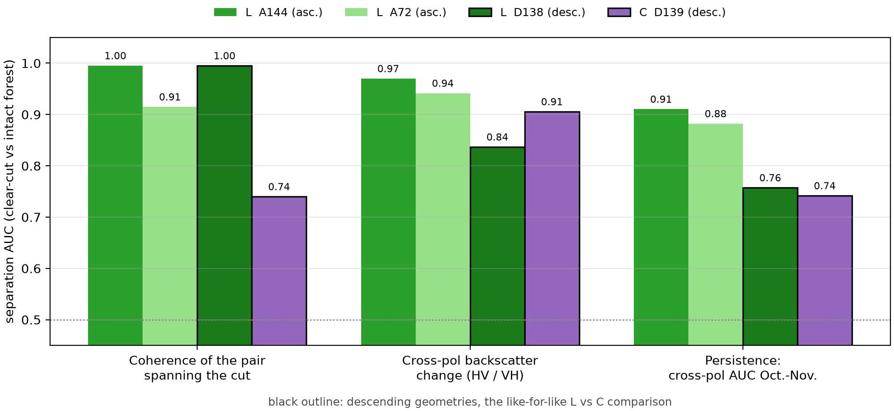
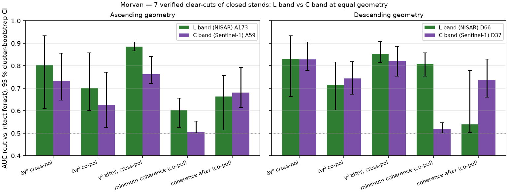

# NISAR vs Sentinel-1 — clear-cut detection feasibility (Vosges, then Morvan) and forested landslide (Séchilienne)

Feasibility test prepared for the SERTIT/ICube internship (L and P bands: NISAR, BIOMASS).

## Question
On a recent clear-cut (Vosges/Alsace, June–Nov. 2026), do **NISAR (L-band, GUNW / GCOV products)**
coherence and backscatter separate the clear-cut from intact forest better than **Sentinel-1 (C-band)**?
Validation with the **Sentinel-2** NDVI difference.

## Main result
On a 2.36 ha clear-cut (early August 2026, near Le Thillot): **yes for coherence**, in all three NISAR geometries; for
backscatter, the L-band advantage **depends on the acquisition geometry**.

| | NISAR (L band) | Sentinel-1 (C band) |
|---|---|---|
| Coherence of the pair spanning the cut (cut vs forest) | 0.29 vs 0.69, **AUC 0.995** (even over 24 days) | 0.23 vs 0.29, AUC 0.71–0.74 |
| 12-day coherence of intact forest | 0.64–0.70 | 0.28 |
| Coherence AUC, all three NISAR geometries | 0.91–0.995 | 0.74 |
| Cross-pol backscatter drop (HV / VH), ascending L (A144) | −4.3 dB, **AUC 0.97** | −2.2 dB, AUC 0.91 |
| Cross-pol backscatter, equal (descending) geometry D138 vs D139 | −2.3 dB, AUC 0.84 | −2.2 dB, AUC 0.91 |
| Contrast in Oct.–Nov. (cross-pol AUC), ascending A144 | 0.91 (persists) | 0.74 (fades; 0.52 on 25/10) |
| Contrast in Oct.–Nov., equal (descending) geometry | 0.76 | 0.74 |



The robust L-band advantage is interferometric (hypotheses H1, H2, H4 confirmed; H3 on backscatter only partly).

Single site: replicated on the Morvan below (tag `v1.0-vosges` marks the Vosges-only state).

## Replication on the Morvan (sylvo-ecoregion G23, Irstea guide)
The Vosges test is replicated on the area of the Irstea clear-cut detection guide (Ose & Deshayes, 2015), whose
method is used twice: as the **optical reference** (on Sentinel-2) and as the **evaluation standard**
(thresholds transposed to radar, area confusion matrix). A 20 × 20 km window gives an **equal-geometry**
comparison in both look directions: L A173 vs C A59 (ascending), L D66 vs C D37 (descending).
The main reference is 7 photo-interpreted clear-cuts of closed stands (15.4 ha).

| | L band (NISAR) | C band (Sentinel-1) |
|---|---|---|
| 12-day coherence of intact forest | 0.35–0.71 | 0.25–0.36 (estimator floor) |
| Minimum coherence AUC, ascending / descending | 0.60 / **0.81** | 0.51 / 0.52 |
| Cross-pol Δγ⁰ AUC, ascending / descending | 0.80 / 0.83 | 0.73 / 0.83 |
| Cohen's d of cross-pol Δγ⁰, ascending / descending | 1.89 / 2.13 | 1.03 / 1.63 |
| Guide method on radar: kappa / cuts found | **0.41 / 5 of 7** | 0.08–0.16 / 2–3 of 7 |
| False alarm audit (15 largest) | 2 probable late cuts | 0 cuts; 8 on plots already open in June |



Findings:
- Same message as in the Vosges: the clear L-band advantage is **interferometric**.
- In backscatter the AUCs are close, but L band gives a stronger contrast. This contrast is what a threshold
  method like the guide's needs.
- The guide's statistical thresholds do not transfer to intra-season Sentinel-2 as is: 8.7 % of the forest is
  flagged, mostly broadleaf senescence.
- Reference quality dominates everything: with the automatic reference, the AUC is 0.51–0.56 in both bands.

| # | Morvan step | Status |
|---|------|--------|
| m1–m3 | IGN data, guide on Sentinel-2, photo-interpretation, radar window | ✅ |
| m4–m5 | NISAR remote reads, Sentinel-1 download and SNAP processing (15 dates per orbit) | ✅ |
| m6–m8 | L vs C comparison (4 references), guide on radar, false alarm audits, dating, tables | ✅ |
| Docs | [EN](docs/replication_morvan/replication_morvan_en.md) · [FR](docs/replication_morvan/replication_morvan_fr.md) | ✅ |
| Reports | [EN PDF](reports/morvan/latex/report_morvan_en.pdf) · [FR PDF](reports/morvan/latex/rapport_morvan_fr.pdf) · [presentation (FR)](reports/morvan/presentation/presentation_morvan_fr.pdf) | ✅ |

Site configuration: [config/sites/morvan.yaml](config/sites/morvan.yaml); scripts: `scripts/morvan/m1_*.py` to `m8_*.py`.

## Landslide (reduced version): Séchilienne, phase under forest
On the forested, unstable slope of Séchilienne (Isère), 17 paired 12/24-day interferograms
(26 Jun – 24 Oct 2026) compare **NISAR GUNW (ISCE3)** with **Sentinel-1** (SNAP, same pairs).

| Median over pairs | L A173 | C A161 | L D138 | C D139 |
|---|---|---|---|---|
| Coherence, forested slope | **0.58** | 0.28 | 0.32 | 0.29 |
| Phase consistency, forested slope | **0.92** | 0.11 | **0.88** | 0.09 |

- **C band is decorrelated under forest at 12 days**: its 0.27–0.30 forest coherence is the estimator
  bias floor. The chain itself is fine, with 0.97–0.99 on built-up areas.
- **L band keeps a consistent phase** through the canopy. This is the necessary condition for
  displacement InSAR under forest, and an argument for NISAR, then ROSE-L.
- **No displacement is detected above noise** in 4 months. The cumulative change ranges from −4 to
  +5 mm, against a per-pair control spread of 3–10 mm. The expected velocity of 1–5 cm/yr is too slow
  for single pairs, so a ≥ 1-year SBAS series is the next step.

| Item | Link |
|---|---|
| Note | [EN](docs/glissement/glissement_sechilienne_en.md) · [FR](docs/glissement/glissement_sechilienne_fr.md) |
| Slides (FR) | [presentation_glissement_fr.pdf](reports/sechilienne/presentation/presentation_glissement_fr.pdf) |
| Config / scripts | [config/sites/sechilienne.yaml](config/sites/sechilienne.yaml) · `scripts/glissement/g0_*.py` to `g4_*.py` |
| Resumable run | `bash scripts/glissement/run_pipeline.sh --install` (systemd user service, capped memory, auto-restart) |

## Steps (Vosges)
| # | Step | Status |
|---|------|--------|
| 0 | Environment, structure, repository, SNAP 14, Earthdata access | ✅ |
| 1 | Scoping — [EN](docs/cadrage/cadrage_en.md) · [FR](docs/cadrage/cadrage_fr.md) | ✅ |
| 2 | S1 / NISAR / BIOMASS inventory — [EN](docs/inventaire/inventaire_en.md) · [FR](docs/inventaire/inventaire_fr.md) | ✅ |
| 3 | Site selection: clear-cut C11 (2.4 ha, July–August 2026) + control forest, S2 NDVI reference — [EN](docs/site/site_en.md) · [FR](docs/site/site_fr.md) | ✅ |
| 4 | Download: NISAR remote window reads, reduced Sentinel-1 SAFE — [EN](docs/acquisition/acquisition_en.md) · [FR](docs/acquisition/acquisition_fr.md) | ✅ |
| 5 | Processing and comparison: L-band coherence separates the cut best in all geometries (AUC 0.91–0.995 vs 0.74); the HV γ⁰ advantage and its autumn persistence hold in ascending geometry only — [EN](docs/comparaison/comparaison_en.md) · [FR](docs/comparaison/comparaison_fr.md) | ✅ |
| 6 | LaTeX report in two complete versions (ROSE-L and ISCE3 cited) — [EN PDF](reports/latex/report_en.pdf) · [FR PDF](reports/latex/rapport_fr.pdf) | ✅ |

Parameters: [config/params.yaml](config/params.yaml).

## Reusable chain
Processing logic lives in the importable package `src/nisar_s1/` (GUNW/GCOV readers, common grid,
statistics, detection), designed for reuse on other sites and for transfer to **ROSE-L**.
Scripts in `scripts/` only call these modules. Details: § 9 of the scoping document.

```bash
conda activate nisar_s1
pip install -e .          # makes "import nisar_s1" available everywhere
```

## Layout
```
config/        parameters (footprint, dates, thresholds) — no secrets
docs/          step documents, in FR and EN
notebooks/     exploration
scripts/       step orchestration (calls nisar_s1)
snap_graphs/   SNAP graphs (.xml)
src/nisar_s1/  reusable modules
tests/         tests on synthetic data
results/       tables and small outputs
reports/       figures + LaTeX reports (FR and EN)
data/raw, data/processed -> links to /media/dell/Transcend1/nisar_data (not versioned)
```

## Environment
```bash
conda env create -f environment.yml
conda activate nisar_s1
```
Credentials: `~/.netrc` (Earthdata, `chmod 600`, script `scripts/setup/create_netrc.sh`), `.env` (ESA/GEE tokens) — excluded from Git.
SNAP 14 (`~/esa-snap`, `-Xmx5G`); test: `bash scripts/setup/test_gpt.sh`.
Machine constraints: ~8 GB RAM → SNAP on a small area (TOPSAR-Split, 2–3 bursts).
