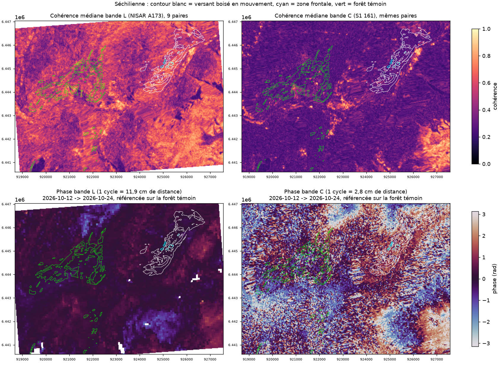
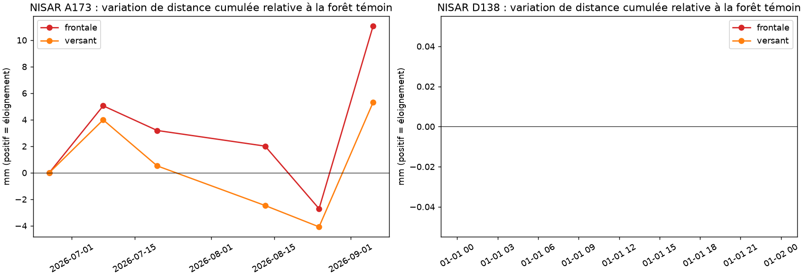

# Séchilienne landslide: radar phase under forest, L band (NISAR) versus C band (Sentinel-1)

*Version française : [glissement_sechilienne_fr.md](glissement_sechilienne_fr.md)*

This note presents a **focused study**, limited to one site and one question: on an unstable
**forested** slope, does L band retain a usable interferometric phase where C band loses it? Precise
displacement measurement is beyond the scope of this study; it is a perspective (§ 7).

## 1. Site

The Ruines de Séchilienne slope (Isère, France) lies on the right bank of the Romanche, on the
south-east flank of Mont Sec. It is one of the most closely monitored landslides in France.

- **Moving area**: roughly 450 to 1,140 m, largely forested.
- **Frontal zone**: bare gneiss scree around 760 m. It is the most active part: it reached several
  metres per year in the early 2010s, then slowed down strongly.
- **Rest of the slope**: the literature reports velocities of about one centimetre per year.

Three zones were built **without using radar** (`g1b_reference.py`). The sources are the Copernicus
30 m DEM, WorldCover, a Sentinel-2 image from 3 Sep 2026, and the frontal zone location published in
the literature.

| Zone | Area | Median elev. | Median slope | Median aspect | Forest |
|---|---|---|---|---|---|
| Frontal (bare scree) | 4.6 ha | 763 m | 50° | 124° | 58 % |
| Moving forested slope | 167.8 ha | 766 m | 40° | 128° | 100 % |
| Stable control forest (> 2.5 km) | 159.7 ha | 799 m | 36° | 165° | 100 % |

The control forest has the same aspect, a similar slope and the same forest type as the moving
slope. It is used as the **phase reference**, so the slope is measured relative to a stable forest.

## 2. Data

| | L band: NISAR | C band: Sentinel-1 |
|---|---|---|
| Product | GUNW L2 (ISCE3, JPL), read remotely | IW SLC, subswath IW2, VV |
| Geometries | A173 (ascending), D138 (descending) | A161 (S1A then S1C) and D139 (S1D) |
| Period | 26 Jun → 24 Oct 2026 | nearest dates to NISAR (gap ≤ 2 days) |
| Pairs | 9 (A173) + 8 (D138), 12 or 24 days | the same 17 pairs |
| λ (one phase cycle) | 23.8 cm (11.9 cm in range) | 5.55 cm (2.8 cm in range) |

The GUNW products are generated by **ISCE3**, NISAR's official processor. They provide coherence,
unwrapped phase, connected components and the ionospheric screen.

The Sentinel-1 interferograms are computed with **SNAP**, using the reusable graph
[`nisar_s1/graphs/s1_interferogram.xml`](https://github.com/mamadou-g-diallo/nisar-s1/blob/v0.4.0/src/nisar_s1/graphs/s1_interferogram.xml):

1. Split, Orbit, Back-Geocoding;
2. interferogram and coherence (10 × 3 window);
3. Deburst, topographic phase removal, 4 × 1 multilook;
4. Terrain-Correction to Lambert 93 at 20 m.

ESD was removed from the chain. The window lies inside a single burst, and ESD returned an all-zero
product on a D139 pair.

## 3. Method

For each pair and sensor, the analysis (`g4_analysis.py`) computes:

- **median coherence** per zone;
- **phase consistency** |⟨e^{jφ}⟩| per zone, after referencing to the circular mean of the
  control forest. It is 1 if the whole zone shares the same phase and 0 if the phase is random.
  This is the key indicator: a phase usable for displacement must be consistent;
- for L band, the **line-of-sight (LOS) range change** relative to the control forest. The unwrapped
  phase is corrected for a planar ramp and a term proportional to elevation (stratified
  troposphere), both fitted outside the landslide. Contiguous pairs are then accumulated.

## 4. Results

### 4.1 Coherence and phase consistency (median over pairs, min–max)

| | L A173 | C A161 | L D138 | C D139 |
|---|---|---|---|---|
| Coherence, slope | **0.58** (0.38–0.81) | 0.28 (0.26–0.35) | 0.32 (0.28–0.39) | 0.29 (0.26–0.33) |
| Coherence, control | **0.60** (0.32–0.78) | 0.27 (0.25–0.34) | 0.43 (0.30–0.57) | 0.28 (0.26–0.36) |
| Coherence, frontal | **0.61** (0.45–0.83) | 0.28 (0.24–0.43) | masked | 0.30 (0.24–0.35) |
| Consistency, slope | **0.92** (0.79–0.99) | 0.11 (0.00–0.53) | **0.88** (0.80–0.93) | 0.09 (0.02–0.20) |
| Consistency, frontal | **0.97** (0.78–1.00) | 0.27 (0.10–0.57) | — | 0.28 (0.10–0.39) |

The Sentinel-1 chain was checked: C-band coherence reaches **0.97–0.99** on built-up areas and
exceeds 0.6 on 10 % of flat non-forest ground, so the processing is correct. The 0.27–0.30 measured
in forest is the **bias floor** of the estimator for about thirty looks: the loss of coherence is
real.



### 4.2 Interpretation

1. **C band is decorrelated over the whole forested slope at 12 days.** Coherence and phase
   consistency are at noise level in both geometries and on all dates.
   - The only exception is the last ascending pair (14 → 26 Oct), with a consistency of 0.53. It
     coincides with leaf fall.
   - The bare frontal zone keeps a partial consistency (median 0.27), too weak and too small
     (4.6 ha) for a measurement.
   - These results match C-band temporal decorrelation by foliage, already seen in the Vosges and
     the Morvan.
2. **L band keeps a consistent phase over the forested slope in ascending geometry**: median
   consistency 0.92, with coherence similar to the control forest. The L-band phase goes through the
   canopy and carries information about the ground, which is the necessary condition for any
   displacement measurement under forest.
3. **The descending geometry is unfavourable.** The slope faces south-east, away from the westward
   descending look. L-band coherence drops to 0.32 there and the frontal zone is masked in the GUNW.
   Consistency stays high (0.88), but it rests on fewer pixels.
4. **No displacement is detected above noise in 4 months.**
   - In ascending geometry, the cumulative range change of the slope relative to the control varies
     between −4 and +5 mm with no trend; it ranges from −3 to +11 mm for the frontal zone.
   - The per-pair spread of the control is 3–10 mm (median 5.9 mm).
   - A motion of 1–5 cm/yr amounts to less than a centimetre over 4 months, which is the level of
     residual atmospheric noise in a 12-day pair.
   - The result is consistent with a landslide that is slow today, but it proves nothing about its
     velocity.



## 5. Conclusion

On this forested slope, the question has a clear answer.

- **C band (Sentinel-1) does not provide a usable phase under forest at 12 days**, whatever the
  geometry.
- **L band (NISAR) does**, with a consistency of 0.8–1 in ascending geometry.

The necessary condition for displacement interferometry under forest cover is therefore met at
L band and not at C band. Going forward, this is the main argument for NISAR, and then for
**ROSE-L** (the Copernicus L-band mission planned around 2029), for monitoring forested landslides.

Measuring the displacement itself is out of reach with 4 months of data. The expected velocity is
too low compared with the noise of a single pair.

## 6. Limitations

- One site, with a single moving forested slope.
- Slow motion: this test measures **coherence**, not **accuracy** on a known displacement.
- No ground data for 2026: the site's monitoring network exists but was not used here.
- Zones built from the literature and imagery, without an official landslide outline.
- The descending geometry is of little use on this slope, and only one polarisation was tested at
  C band (VV).
- The coherence estimators differ: ISCE3 multilooked GUNW for L, SNAP 10 × 3 window for C. **Phase
  consistency**, computed in the same way for both sensors, is therefore the comparison indicator
  used here.

## 7. Perspectives

- A longer NISAR **time series** (at least one year, every 12 days), inverted with SBAS using tools
  from the ISCE3 ecosystem (MintPy, for instance), to reach mm/yr.
- A comparison with the site's geodetic and extensometer measurements.
- Transfer to ROSE-L: the chain is sensor-independent (`nisar_s1` package).

## 8. Reproduction

```
python scripts/glissement/g0_site.py          # DEM, forest, Sentinel-2
python scripts/glissement/g1b_reference.py    # frontal / slope / control zones
python scripts/glissement/g1_fetch_nisar.py   # NISAR GUNW, remote read
bash   scripts/glissement/run_pipeline.sh --install   # g2 + g3 + g4 as a resumable service
```

`run_pipeline.sh --install` runs the Sentinel-1 download, SNAP and then the analysis in a
systemd user service. Memory is capped there, the service restarts by itself and the steps are
idempotent. `GL_XMX` sets the Java heap; 2 GB is enough.

## References

- NISAR: Kellogg et al. (2020), *NASA-ISRO Synthetic Aperture Radar (NISAR) mission*, IEEE Aerospace Conf.
- ISCE3: JPL, *InSAR Scientific Computing Environment 3*, https://github.com/isce-framework/isce3
- ROSE-L: ESA (2020), *Copernicus L-band SAR Mission Requirements Document*.
- Sentinel-1: Torres et al. (2012), *GMES Sentinel-1 mission*, Remote Sens. Environ.
- Decorrelation: Zebker and Villasenor (1992), *Decorrelation in interferometric radar echoes*, IEEE TGRS.
- SNAP: ESA, *Sentinel Application Platform*.
- WorldCover: Zanaga et al. (2022), ESA WorldCover 10 m 2021 v200.
