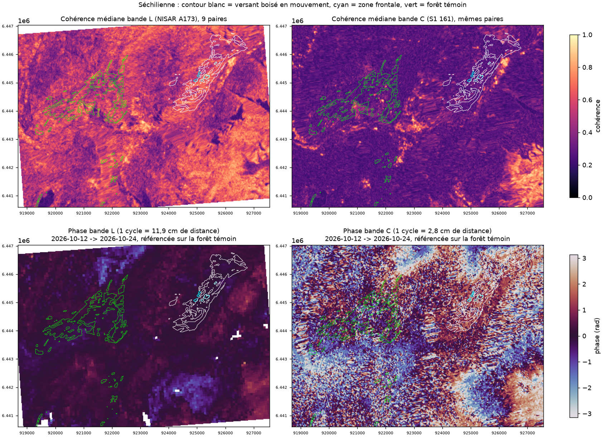
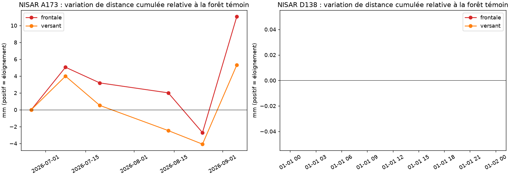

# Glissement de Séchilienne : la phase radar sous la forêt, bande L (NISAR) contre bande C (Sentinel-1)

*English version: [glissement_sechilienne_en.md](glissement_sechilienne_en.md)*

Cette note présente une **étude ciblée**, limitée à un site et à une question : sur un versant
**boisé** et instable, la bande L conserve-t-elle une phase interférométrique exploitable là où la
bande C la perd ? La mesure fine des déplacements sort du cadre de cette étude ; elle constitue une
perspective (§ 7).

## 1. Site

Le versant des Ruines de Séchilienne (Isère) se trouve en rive droite de la Romanche, sur le flanc
sud-est du Mont Sec. C'est l'un des glissements les plus surveillés de France.

- **Zone en mouvement** : de 450 à 1 140 m environ. Elle est en grande partie boisée.
- **Zone frontale** : des éboulis de gneiss nus vers 760 m. C'est la partie la plus active : elle
  a atteint plusieurs mètres par an au début des années 2010, puis a fortement ralenti.
- **Reste du versant** : la littérature donne des vitesses de l'ordre du centimètre par an.

Trois zones ont été construites **sans utiliser le radar** (script `g1b_reference.py`). Les sources
sont le MNT Copernicus 30 m, WorldCover, une image Sentinel-2 du 3/09/2026 et la position de la zone
frontale publiée dans la littérature.

| Zone | Surface | Altitude méd. | Pente méd. | Exposition méd. | Forêt |
|---|---|---|---|---|---|
| Frontale (éboulis nus) | 4,6 ha | 763 m | 50° | 124° | 58 % |
| Versant boisé en mouvement | 167,8 ha | 766 m | 40° | 128° | 100 % |
| Forêt témoin stable (> 2,5 km) | 159,7 ha | 799 m | 36° | 165° | 100 % |

Le témoin a la même exposition, une pente voisine et le même type de forêt que le versant. Il sert
de **référence de phase**, ce qui revient à mesurer le versant relativement à une forêt stable.

## 2. Données

| | Bande L : NISAR | Bande C : Sentinel-1 |
|---|---|---|
| Produit | GUNW L2 (ISCE3, JPL), lu à distance | IW SLC, sous-andain IW2, polarisation VV |
| Géométries | A173 (ascendante), D138 (descendante) | A161 (S1A puis S1C) et D139 (S1D) |
| Période | 26/06 → 24/10/2026 | dates les plus proches de NISAR (écart ≤ 2 j) |
| Paires | 9 (A173) + 8 (D138), 12 ou 24 jours | les mêmes 17 paires |
| λ (1 cycle de phase) | 23,8 cm (11,9 cm en distance) | 5,55 cm (2,8 cm en distance) |

Les produits GUNW sont générés par **ISCE3**, le processeur officiel de NISAR. Ils fournissent la
cohérence, la phase déroulée, les composantes connexes et l'écran ionosphérique.

Les interférogrammes Sentinel-1 sont calculés avec **SNAP** (graphe réutilisable
[`nisar_s1/graphs/s1_interferogram.xml`](https://github.com/mamadou-g-diallo/nisar-s1/blob/v0.4.0/src/nisar_s1/graphs/s1_interferogram.xml)) :

1. Split, Orbit, Back-Geocoding ;
2. interférogramme et cohérence (fenêtre 10 × 3) ;
3. Deburst, retrait de la phase topographique, multivue 4 × 1 ;
4. Terrain-Correction en Lambert 93 à 20 m.

La correction ESD a été retirée de la chaîne. La fenêtre tient dans un seul burst, et l'ESD
renvoyait un produit nul sur la paire D139.

## 3. Méthode

Pour chaque paire et chaque capteur, l'analyse (`g4_analysis.py`) calcule les grandeurs suivantes :

- **Cohérence médiane** par zone.
- **Consistance de phase** |⟨e^{jφ}⟩| par zone, après référencement sur la moyenne circulaire du
  témoin. Elle vaut 1 si toute la zone a la même phase et 0 si la phase y est aléatoire. C'est
  l'indicateur clé : une phase utilisable pour mesurer un déplacement doit être consistante.
- **Variation de distance en visée** (LOS), relative au témoin, pour la bande L. La phase déroulée
  est corrigée d'une rampe plane et d'un terme proportionnel à l'altitude (troposphère stratifiée),
  ajustés hors du glissement. Les paires contiguës sont ensuite cumulées.

## 4. Résultats

### 4.1 Cohérence et consistance de phase (médianes sur les paires, min–max)

| | L A173 | C A161 | L D138 | C D139 |
|---|---|---|---|---|
| Cohérence, versant | **0,58** (0,38–0,81) | 0,28 (0,26–0,35) | 0,32 (0,28–0,39) | 0,29 (0,26–0,33) |
| Cohérence, témoin | **0,60** (0,32–0,78) | 0,27 (0,25–0,34) | 0,43 (0,30–0,57) | 0,28 (0,26–0,36) |
| Cohérence, frontale | **0,61** (0,45–0,83) | 0,28 (0,24–0,43) | masquée | 0,30 (0,24–0,35) |
| Consistance, versant | **0,92** (0,79–0,99) | 0,11 (0,00–0,53) | **0,88** (0,80–0,93) | 0,09 (0,02–0,20) |
| Consistance, frontale | **0,97** (0,78–1,00) | 0,27 (0,10–0,57) | — | 0,28 (0,10–0,39) |

La chaîne Sentinel-1 a été contrôlée : la cohérence C atteint **0,97 à 0,99** sur le bâti et
dépasse 0,6 sur 10 % des terrains plats non boisés. Le traitement est donc correct. Les 0,27–0,30
mesurés en forêt correspondent au **plancher de biais** de l'estimateur pour une trentaine de vues :
c'est une perte de cohérence réelle.



### 4.2 Lecture

1. **La bande C est décorrélée sur tout le versant boisé à 12 jours.** Cohérence et consistance de
   phase y sont au niveau du bruit, dans les deux géométries et pour toutes les dates.
   - La seule exception est la dernière paire ascendante (14 → 26/10), avec une consistance de
     0,53. Elle coïncide avec la chute des feuilles.
   - La zone frontale, en éboulis nus, garde une consistance partielle (0,27 en médiane), trop
     faible et trop petite (4,6 ha) pour une mesure.
   - Ces résultats sont cohérents avec la décorrélation temporelle de la bande C par le feuillage,
     déjà observée dans les Vosges et le Morvan.
2. **La bande L garde une phase consistante sur le versant boisé en ascendante** : consistance
   médiane de 0,92, cohérence comparable à la forêt témoin. La phase L traverse la canopée et porte
   une information sur le sol, ce qui est la condition nécessaire à toute mesure de déplacement sous
   forêt.
3. **La géométrie descendante est défavorable.** Le versant est orienté au sud-est, à l'opposé de la
   visée descendante (vers l'ouest). La cohérence L y tombe à 0,32 et la zone frontale est masquée
   dans le GUNW. La consistance reste élevée (0,88), mais elle repose sur moins de pixels.
4. **Aucun déplacement n'est détecté au-dessus du bruit en 4 mois.**
   - En ascendante, la variation de distance cumulée du versant relativement au témoin oscille
     entre −4 et +5 mm, sans tendance ; elle va de −3 à +11 mm pour la zone frontale.
   - La dispersion du témoin par paire est de 3 à 10 mm (médiane 5,9 mm).
   - Un mouvement de 1 à 5 cm/an représente moins d'un centimètre sur 4 mois, soit le niveau du
     bruit atmosphérique résiduel d'une paire de 12 jours.
   - Le résultat est cohérent avec un glissement aujourd'hui lent, mais il ne démontre rien sur sa
     vitesse.



## 5. Conclusion

Sur ce versant boisé, la question posée a une réponse nette.

- **La bande C (Sentinel-1) ne fournit pas de phase exploitable sous la forêt à 12 jours**, quelle
  que soit la géométrie.
- **La bande L (NISAR) en fournit une**, avec une consistance de 0,8 à 1 en géométrie ascendante.

La condition nécessaire à l'interférométrie de déplacement sous couvert forestier est donc remplie
en bande L et pas en bande C. Pour la suite, c'est l'argument principal en faveur de NISAR, puis de
**ROSE-L** (mission Copernicus en bande L prévue vers 2028), pour le suivi des glissements boisés.

La mesure du déplacement lui-même n'est pas atteinte avec 4 mois de données. La vitesse attendue
est trop faible devant le bruit d'une paire isolée.

## 6. Limites

- Un seul site, avec un seul versant boisé en mouvement.
- Mouvement lent : ce test mesure la **cohérence**, pas la **précision** sur un déplacement connu.
- Pas de données au sol pour 2026 : le réseau de suivi du site existe mais n'a pas été utilisé ici.
- Zones construites à partir de la littérature et de l'imagerie, sans contour officiel du
  glissement.
- La géométrie descendante est peu exploitable sur ce versant, et une seule polarisation a été
  testée pour la bande C (VV).
- Les estimateurs de cohérence diffèrent : GUNW multivue d'ISCE3 pour L, fenêtre 10 × 3 de SNAP
  pour C. La **consistance de phase**, calculée de la même façon pour les deux capteurs, est donc
  l'indicateur de comparaison retenu.

## 7. Perspectives

- Une **série temporelle** NISAR plus longue (au moins un an, tous les 12 jours), inversée en SBAS
  avec les outils de l'écosystème ISCE3 (MintPy par exemple), pour atteindre le mm/an.
- Une comparaison aux mesures géodésiques et extensométriques du site.
- La transposition à ROSE-L : la chaîne est indépendante du capteur (module `nisar_s1`).

## 8. Reproduction

```
python scripts/glissement/g0_site.py          # MNT, forêt, Sentinel-2
python scripts/glissement/g1b_reference.py    # zones frontale / versant / témoin
python scripts/glissement/g1_fetch_nisar.py   # GUNW NISAR à distance
bash   scripts/glissement/run_pipeline.sh --install   # g2 + g3 + g4 en service reprenable
```

`run_pipeline.sh --install` lance le téléchargement Sentinel-1, SNAP puis l'analyse dans un
service systemd utilisateur. La mémoire y est plafonnée, le service redémarre seul et les étapes
sont idempotentes. La variable `GL_XMX` règle le tas Java : 2 Go suffisent.

## Références

- NISAR : Kellogg et al. (2020), *NASA-ISRO Synthetic Aperture Radar (NISAR) mission*, IEEE Aerospace Conf.
- ISCE3 : JPL, *InSAR Scientific Computing Environment 3*, https://github.com/isce-framework/isce3
- ROSE-L : ESA (2020), *Copernicus L-band SAR Mission Requirements Document*.
- Sentinel-1 : Torres et al. (2012), *GMES Sentinel-1 mission*, Remote Sens. Environ.
- Décorrélation : Zebker et Villasenor (1992), *Decorrelation in interferometric radar echoes*, IEEE TGRS.
- SNAP : ESA, *Sentinel Application Platform*.
- WorldCover : Zanaga et al. (2022), ESA WorldCover 10 m 2021 v200.
