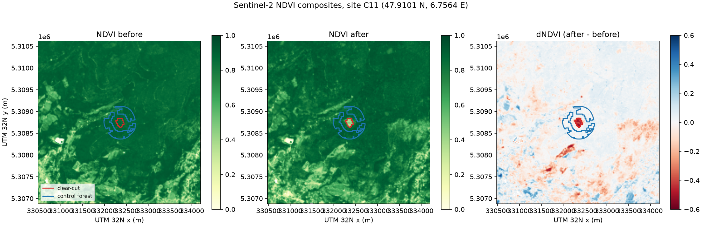
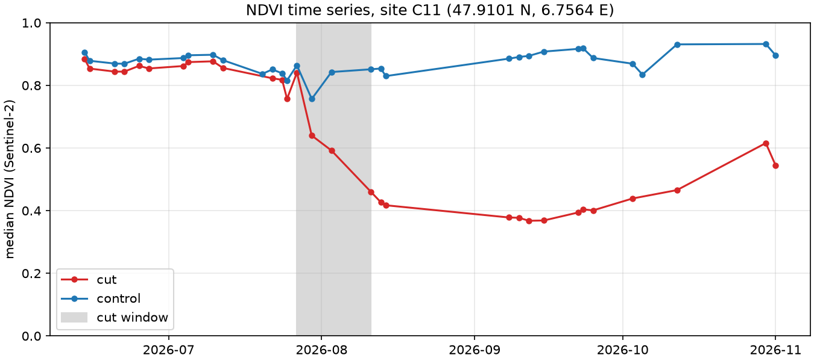
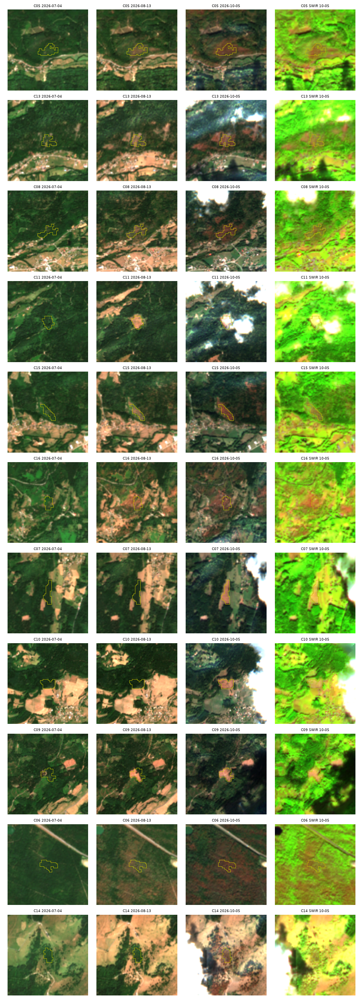

# Step 3 — Site selection and Sentinel-2 reference

*Version française : [site_fr.md](site_fr.md)*

## Summary

Selected site: **clear-cut C11, 2.36 ha, 47.910° N – 6.756° E** (Vosges mountains, upper Moselle valley,
Le Thillot area), harvested between **27 July and 11 August 2026** inside continuous forest. Control:
**ring of intact forest 100–275 m around the cut (21.8 ha)** with stable NDVI.
Geometries: `config/site.geojson` (field `role` = `cut` / `control`, cut window `cut_after` / `cut_before`).

| | Clear-cut C11 | Control forest |
|---|---|---|
| Area | 2.36 ha (≈ 59 pixels at 20 m) | 21.8 ha |
| Median NDVI before (June–July) | 0.86 | 0.87 |
| NDVI after (September–October) | 0.37–0.45 | 0.85–0.92 |
| Clear S2 dates (June → Nov.) | 30 | 32 |

## Method

1. **Automatic detection** (`scripts/03_site_candidates.py`, modules `optical` and `sites`) on S2 tiles
   32ULU and 32ULV at 20 m:
   - median NDVI composites before (24/06, 25/06, 04/07, 10/07) and after (23/09, 25/09, 05/10, 12/10);
     a pixel is kept only if clear on at least 2 dates (SCL classes 4-5-6, blue > 0.12 test);
   - ESA WorldCover 2021 forest mask (class 10) to exclude crop harvests;
   - pixels with NDVI before ≥ 0.7 and dNDVI ≤ −0.3, 2×2 morphological opening, connected groups ≥ 2 ha.
   Result: **16 candidates** (2.0 to 5.2 ha). No clean summer clear-cut ≥ 5 ha exists in the area during the
   period with NISAR data (June → November 2026), hence the threshold lowered to 2 ha (≥ 50 pixels at 20 m,
   enough for polygon statistics).
2. **Temporal check** (`scripts/03b_verify_candidates.py`): median NDVI series of every candidate over all S2
   dates (≤ 50 % cloud); a drop is kept if **persistent** (≥ 75 % of the dates after the window, and at least 2).
   All 16 candidates have a persistent drop, which does not separate a clear-cut from dieback.
3. **Visual check** (`scripts/03d_candidate_quicklooks.py`): true-colour chips (04/07, 13/08, 05/10) and
   SWIR-NIR-red false colour.

| Candidates | Diagnosis | Decision |
|---|---|---|
| C01, C12 | pond edge (water level) | rejected |
| C02 | Ill riparian forest (Erstein), phenology | rejected |
| C03 = C04 | same object seen on two tiles, north of the area | not kept |
| C05, C06, C08, C13, C14, C15, C16 | gradual crown browning (bark beetle / drought), no bare soil | rejected (dieback) |
| C07, C10 | meadow or field edge | rejected (ambiguous) |
| C09 | real clear-cut, but early (10–20 July): few radar pairs before the cut | possible replication site |
| **C11** | **sudden bare soil and slash (pink in SWIR) inside continuous forest** | **selected** |

4. **Control forest** (`scripts/03c_select_site.py`, `sites.control_forest`): forest pixels (WorldCover),
   NDVI before ≥ 0.7 and |dNDVI| ≤ 0.05, in a 100–1000 m ring around the cut; the main component is kept and
   reduced to its closest part (100–275 m). It shares slope, elevation and stand type with the cut; the 100 m
   gap avoids edge effects.

## Cut date

The C11 NDVI goes from 0.84 (27/07) to 0.64 (30/07), 0.59 (03/08) and 0.42–0.46 (11–13/08): felling starts
between 27 and 30 July and harvesting (felling, skidding) lasts about two weeks. Radar acquisitions are
classified with the conservative window **27/07 → 11/08**: an image is "before" if earlier than 27/07,
"after" if later than 11/08; an interferometric pair "spans" the cut if it brackets the whole window.

This timing is favourable: with NISAR (12-day pairs from 19–24 June) and Sentinel-1 (orbit D139, 12 days from
14 June) there are **2–3 pairs before the cut, one spanning pair and 6–8 pairs after**.

## Limitations

- A single 2.4 ha clear-cut: statistics use about 50 pixels at 20 m (after a one-pixel erosion) and are
  spatially autocorrelated; confidence intervals use a block bootstrap.
- The S2 reference is a greenness index: it dates the cut within a few days but does not give removed biomass.
- For the pixel-wise detection score, the analysis window (≈ 3.7 × 3.7 km) contains other changes (cuts and
  dieback); they are used as additional reference (dNDVI ≤ −0.3 in forest).

## Outputs

- `config/site.geojson`: cut / control polygons and cut window
- `results/site_candidates.geojson`, `results/tables/site_candidates*.csv`: candidates, check, series
- `results/tables/site_timeseries.csv`: NDVI series of the cut and the control
- `results/figures/site_ndvi_maps.png`, `site_ndvi_timeseries.png`, `candidates_rgb_quicklooks.png`
