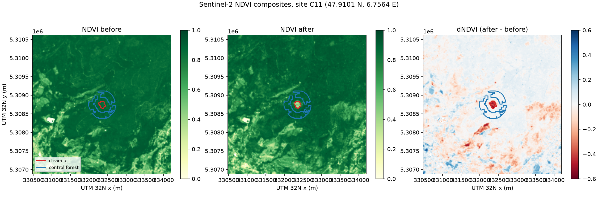
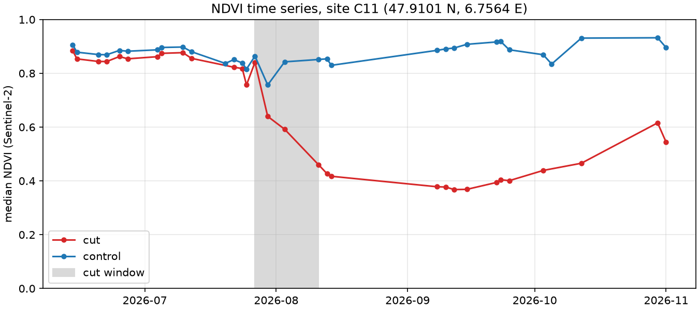
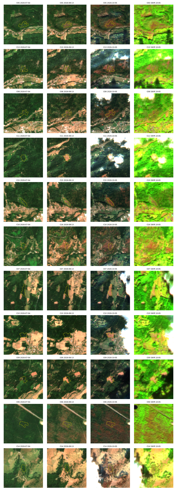

# Étape 3 — Choix du site et référence Sentinel-2

*English version: [site_en.md](site_en.md)*

## Résumé

Site retenu : **coupe rase C11, 2,36 ha, 47,910° N – 6,756° E** (massif des Vosges, haute vallée de la
Moselle, secteur du Thillot), réalisée entre le **27 juillet et le 11 août 2026**, au milieu d'une forêt
continue. Forêt témoin : **anneau de forêt intacte de 100 à 275 m autour de la coupe (21,8 ha)**, NDVI stable.
Géométries : `config/site.geojson` (champ `role` = `cut` / `control`, fenêtre de coupe `cut_after` / `cut_before`).

| | Coupe C11 | Forêt témoin |
|---|---|---|
| Surface | 2,36 ha (≈ 59 pixels à 20 m) | 21,8 ha |
| NDVI médian avant (juin–juillet) | 0,86 | 0,87 |
| NDVI après (septembre–octobre) | 0,37–0,45 | 0,85–0,92 |
| Dates S2 claires (juin → nov.) | 30 | 32 |

## Démarche

1. **Détection automatique** (`scripts/03_site_candidates.py`, modules `optical` et `sites`) sur les tuiles
   S2 32ULU et 32ULV, à 20 m :
   - composites médians de NDVI avant (24/06, 25/06, 04/07, 10/07) et après (23/09, 25/09, 05/10, 12/10) ;
     un pixel n'est retenu que s'il est clair sur au moins 2 dates (classes SCL 4-5-6, test bleu > 0,12) ;
   - masque forêt ESA WorldCover 2021 (classe 10) pour exclure les récoltes agricoles ;
   - pixels NDVI avant ≥ 0,7 et dNDVI ≤ −0,3, ouverture morphologique 2×2, groupes connexes ≥ 2 ha.
   Résultat : **16 candidats** (2,0 à 5,2 ha). Aucune coupe estivale nette ≥ 5 ha n'existe dans la zone sur la
   période où NISAR acquiert des données (juin → novembre 2026), d'où le seuil abaissé à 2 ha
   (≥ 50 pixels à 20 m, assez pour des statistiques par polygone).
2. **Vérification temporelle** (`scripts/03b_verify_candidates.py`) : série NDVI médiane de chaque candidat sur
   toutes les dates S2 (≤ 50 % de nuages) ; une baisse est retenue si elle est **persistante** (≥ 75 % des dates
   après la fenêtre, et au moins 2). Les 16 candidats ont une baisse persistante, ce qui ne suffit pas à
   distinguer une coupe d'un dépérissement.
3. **Contrôle visuel** (`scripts/03d_candidate_quicklooks.py`) : imagettes en couleurs vraies (04/07, 13/08,
   05/10) et en fausses couleurs SWIR-PIR-rouge.

| Candidats | Diagnostic | Décision |
|---|---|---|
| C01, C12 | bord d'étang (niveau d'eau) | rejetés |
| C02 | ripisylve de l'Ill (Erstein), phénologie | rejeté |
| C03 = C04 | même objet vu sur deux tuiles, nord de la zone | non retenu |
| C05, C06, C08, C13, C14, C15, C16 | brunissement progressif des houppiers (scolytes / sécheresse), pas de sol nu | rejetés (dépérissement) |
| C07, C10 | bordure de prairie ou de champ | rejetés (ambigus) |
| C09 | vraie coupe, mais précoce (10–20 juillet) : peu de paires radar avant la coupe | site de réplication possible |
| **C11** | **apparition brutale de sol nu et rémanents (rose en SWIR) dans une forêt continue** | **retenu** |

4. **Forêt témoin** (`scripts/03c_select_site.py`, `sites.control_forest`) : pixels forestiers (WorldCover),
   NDVI avant ≥ 0,7 et |dNDVI| ≤ 0,05, dans un anneau de 100 à 1 000 m autour de la coupe ; on garde la
   composante principale, réduite à la partie la plus proche (100–275 m). Ce témoin partage le versant,
   l'altitude et le peuplement de la coupe ; la marge de 100 m évite les effets de lisière.

## Date de la coupe

La série NDVI de C11 passe de 0,84 (27/07) à 0,64 (30/07), 0,59 (03/08) puis 0,42–0,46 (11–13/08) :
l'abattage commence entre le 27 et le 30 juillet et l'exploitation (abattage, débardage) dure environ deux
semaines. Pour classer les acquisitions radar, la fenêtre prudente **27/07 → 11/08** est utilisée :
une image est « avant » si elle est antérieure au 27/07, « après » si elle est postérieure au 11/08 ;
une paire interférométrique est « à cheval » si elle encadre toute la fenêtre.

Cette date est favorable : avec NISAR (paires de 12 jours à partir du 19–24 juin) et Sentinel-1
(orbite D139, 12 jours à partir du 14 juin), on dispose de **2 à 3 paires avant la coupe, d'une paire à cheval
et de 6 à 8 paires après**.

## Limites

- Une seule coupe de 2,4 ha : les statistiques portent sur environ 50 pixels à 20 m (après érosion d'un pixel)
  et sont spatialement autocorrélées ; les intervalles de confiance sont estimés par bootstrap par blocs.
- La référence S2 est un indice de verdeur : elle date la coupe à quelques jours près mais ne donne pas la
  biomasse enlevée.
- Pour l'évaluation pixel à pixel de la détection, la fenêtre d'analyse (≈ 3,7 × 3,7 km) contient d'autres
  changements (coupes et dépérissements) ; ils servent de vérité terrain supplémentaire (dNDVI ≤ −0,3 en forêt).

## Fichiers produits

- `config/site.geojson` : polygones coupe / témoin et fenêtre de coupe
- `results/site_candidates.geojson`, `results/tables/site_candidates*.csv` : candidats, vérification, séries
- `results/tables/site_timeseries.csv` : séries NDVI de la coupe et du témoin
- `results/figures/site_ndvi_maps.png`, `site_ndvi_timeseries.png`, `candidates_rgb_quicklooks.png`
