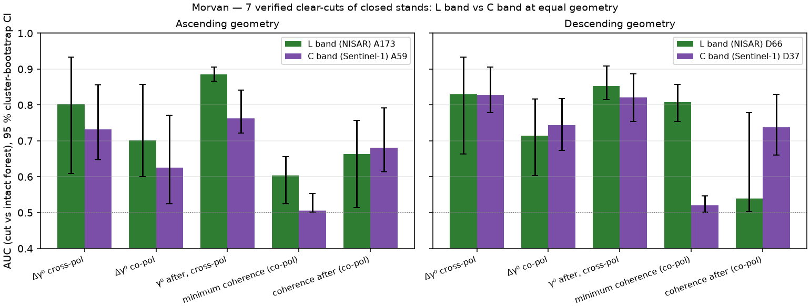

# Morvan — replication on 7 clear-cuts with the Irstea guide

The Vosges test is replicated on the area of the Irstea clear-cut detection guide (Ose & Deshayes, 2015,
sylvo-ecoregion G23), whose method is used twice: as the **optical reference** (on Sentinel-2) and as the
**evaluation standard** (thresholds transposed to radar, area confusion matrix). A 20 × 20 km window gives an
**equal-geometry** comparison in both look directions: L A173 vs C A59 (ascending), L D66 vs C D37 (descending).
The main reference is 7 photo-interpreted clear-cuts of closed stands (15.4 ha).

| | L band (NISAR) | C band (Sentinel-1) |
|---|---|---|
| 12-day coherence of intact forest | 0.35–0.71 | 0.25–0.36 (estimator floor) |
| Minimum coherence AUC, ascending / descending | 0.60 / **0.81** | 0.51 / 0.52 |
| Cross-pol Δγ⁰ AUC, ascending / descending | 0.80 / 0.83 | 0.73 / 0.83 |
| Cohen's d of cross-pol Δγ⁰, ascending / descending | 1.89 / 2.13 | 1.03 / 1.63 |
| Guide method on radar: kappa / cuts found | **0.41 / 5 of 7** | 0.08–0.16 / 2–3 of 7 |
| False alarm audit (15 largest) | 2 probable late cuts | 0 cuts; 8 on plots already open in June |

- Same message as in the Vosges: the clear L-band advantage is **interferometric**.
- In backscatter the AUCs are close, but L band gives a stronger contrast, which is what a threshold method like the
  guide's needs.
- The guide's statistical thresholds do not transfer to intra-season Sentinel-2 as is: 8.7 % of the forest is
  flagged, mostly broadleaf senescence.
- Reference quality dominates everything: with the automatic reference, the AUC is 0.51–0.56 in both bands.

**Poster (French):** [poster/poster_forets_fr.pdf](../poster/poster_forets_fr.pdf) ·
**Note:** [EN](docs/replication_morvan_en.md) · [FR](docs/replication_morvan_fr.md)

Site configuration: [config/sites/morvan.yaml](../config/sites/morvan.yaml). Scripts `morvan/scripts/m1_*.py` to
`m8_*.py`, run from the repository root in that order (the full list with options is in the report appendix).
