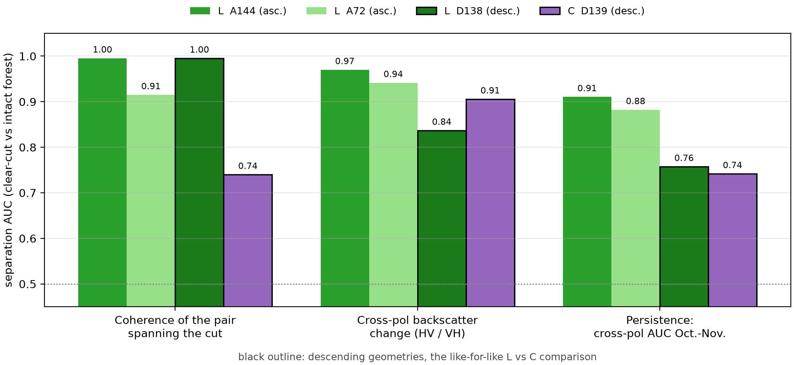

# Vosges — clear-cut C11, NISAR (L band) vs Sentinel-1 (C band)

**Question.** On a recent clear-cut (2.36 ha, cut early August 2026 near Le Thillot), do NISAR coherence and
backscatter (GUNW / GCOV products) separate the cut from intact forest better than Sentinel-1? The reference is the
Sentinel-2 NDVI difference.

**Answer.** Yes for coherence, in all three NISAR geometries; for backscatter, the L-band advantage depends on the
acquisition geometry.

| | NISAR (L band) | Sentinel-1 (C band) |
|---|---|---|
| Coherence of the pair spanning the cut (cut vs forest) | 0.29 vs 0.69, **AUC 0.995** (even over 24 days) | 0.23 vs 0.29, AUC 0.71–0.74 |
| 12-day coherence of intact forest | 0.64–0.70 | 0.28 |
| Coherence AUC, all three NISAR geometries | 0.91–0.995 | 0.74 |
| Cross-pol backscatter drop (HV / VH), ascending L (A144) | −4.3 dB, **AUC 0.97** | −2.2 dB, AUC 0.91 |
| Cross-pol backscatter, equal (descending) geometry D138 vs D139 | −2.3 dB, AUC 0.84 | −2.2 dB, AUC 0.91 |
| Contrast in Oct.–Nov. (cross-pol AUC), ascending A144 | 0.91 (persists) | 0.74 (fades; 0.52 on 25/10) |
| Contrast in Oct.–Nov., equal (descending) geometry | 0.76 | 0.74 |



**Report:** [English (PDF)](report/report_en.pdf) · [French (PDF)](report/rapport_fr.pdf)

## Step notes

| Step | Note |
|---|---|
| Scoping: question, hypotheses, method | [EN](docs/cadrage/cadrage_en.md) · [FR](docs/cadrage/cadrage_fr.md) |
| Sentinel-1 / NISAR / BIOMASS inventory | [EN](docs/inventaire/inventaire_en.md) · [FR](docs/inventaire/inventaire_fr.md) |
| Site selection: clear-cut C11 and control forest | [EN](docs/site/site_en.md) · [FR](docs/site/site_fr.md) |
| Download: NISAR windowed reads, reduced Sentinel-1 SAFE | [EN](docs/acquisition/acquisition_en.md) · [FR](docs/acquisition/acquisition_fr.md) |
| Processing and comparison | [EN](docs/comparaison/comparaison_en.md) · [FR](docs/comparaison/comparaison_fr.md) |

## Scripts (run from the repository root)

```bash
python vosges/scripts/02_inventory.py               # ASF inventory
python vosges/scripts/03_site_candidates.py         # candidate clear-cuts (Sentinel-2)
python vosges/scripts/03b_verify_candidates.py      # temporal check
python vosges/scripts/03c_select_site.py --cand C11 # site and control forest
python vosges/scripts/04_fetch_nisar.py             # remote NISAR windows
python vosges/scripts/04_fetch_s1.py --start 2026-06-14 --end 2026-11-07
python vosges/scripts/05a_process_s1.py             # SNAP: 13 gamma0 and 12 coherences
python vosges/scripts/05b_compare.py                # comparison
python vosges/scripts/06_make_tables.py             # LaTeX tables (FR, EN)
python vosges/scripts/07_summary_figure.py          # summary figure
python vosges/scripts/08_auc_matrix.py              # AUC matrix
```

Parameters: [config/params.yaml](../config/params.yaml); site polygons: [config/site.geojson](../config/site.geojson).
The tag `v1.0-vosges` marks the Vosges-only state of the repository.
